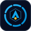

# Andvari

<div align="center">
  
  <h3>Zero-database multi-tenant WebDAV server with OIDC for shared storage</h3>
</div>

---

**Andvari** is a lightweight, zero-database multi-tenant WebDAV server with a web portal for token management, client onboarding, and file browsing.

## Key Features

- **Zero External Database**: User metadata is stored as JSON in `/config/users/{username}.json` with atomic file swapping.
- **Two-Layer Fast Token Authentication**:
  - Passwords/tokens are stored at rest using secure **Argon2id** hashes.
  - WebDAV requests verify against a sub-microsecond in-memory HMAC cache salted with an ephemeral startup key, completely bypassing Argon2id on high-frequency requests.
  - Cache invalidation via file `mtime` inspection ensures instant revocation on token updates.
- **Strict Tenant Isolation**: Scopes each authenticated WebDAV connection directly to `/data/users/{username}/`, preventing access to other tenants or parent directories.
- **Token Rotation**: Supports up to 20 active tokens per user at any time for multi-device access and zero-downtime rotation.
- **First-Login Splash & Onboarding**: Automatically provisions user directories and displays an interactive connection guide with copyable credentials and instructions for macOS Finder, Windows Explorer, GNOME Files, and rclone.
- **Web File Explorer**: Built-in dark mode file manager supporting folder browsing, file downloading, and file/folder deletion.
- **Admin Impersonation**: Users in the designated admin group can view and manage any tenant's dashboard and storage directly via a dropdown selector.
- **Single Static Binary**: React frontend is embedded directly into the Go binary (`embed.FS`).

---

## Configuration

Configure Andvari using the following environment variables:

| Variable | Description | Default |
|---|---|---|
| `CONFIG_PATH` | Shared filesystem path for user metadata JSON files | `/config` |
| `STORAGE_PATH` | Shared filesystem path for user data directories | `/data` |
| `LISTEN_ADDR` | TCP address to bind HTTP and WebDAV server to | `:8080` |
| `OIDC_ISSUER_URL` | Base URL of your OpenID Connect provider (e.g. Pocket ID) | *Required* |
| `OIDC_CLIENT_ID` | OIDC client identifier | *Required* |
| `OIDC_CLIENT_SECRET` | OIDC client secret | *Required* |
| `OIDC_REDIRECT_URL` | Full callback URL (e.g. `https://andvari.domain.com/auth/callback`) | *Required* |
| `OIDC_SCOPES` | Scopes requested during OIDC authorization | `openid profile email groups` |
| `OIDC_ADMIN_GROUP` | OIDC group name whose members gain admin impersonation | `admin` |
| `OIDC_USERNAME_CLAIM` | Claim used to derive the local username | `preferred_username` |
| `SESSION_SECRET` | 32-byte secret for encrypted session cookies | *Auto-generated* |
| `DEV_MODE` | Enable local dev mode without an external OIDC provider | `false` |

---

## Storage Layout

```
/config/
  users/
    alice.json
    bob.json

/data/
  users/
    alice/
      documents/
      photos/
    bob/
      backups/
```

---

## Running with Docker / Podman

```bash
docker run -d \
  --name andvari \
  -p 8080:8080 \
  -v /path/to/shared/config:/config \
  -v /path/to/shared/data:/data \
  -e OIDC_ISSUER_URL="https://id.example.com" \
  -e OIDC_CLIENT_ID="andvari" \
  -e OIDC_CLIENT_SECRET="secret" \
  -e OIDC_REDIRECT_URL="https://andvari.example.com/auth/callback" \
  -e OIDC_ADMIN_GROUP="admin" \
  -e DEFAULT_QUOTA="10GB" \
  ghcr.io/t0ggl/andvari:latest
```

### Environment Variables

| Variable | Default | Description |
|---|---|---|
| `CONFIG_PATH` | `/config` | Path where user configuration JSON files are stored |
| `STORAGE_PATH` | `/data` | Path where user file directories are stored |
| `LISTEN_ADDR` | `:8080` | Address and port to bind the server |
| `DEFAULT_QUOTA` | `0` (unlimited) | Global default quota per user (e.g. `10GB`, `500MB`, `1TB`, `unlimited`) |
| `OIDC_ISSUER_URL` | | OpenID Connect discovery URL |
| `OIDC_CLIENT_ID` | | OIDC Client ID |
| `OIDC_CLIENT_SECRET` | | OIDC Client Secret |
| `OIDC_REDIRECT_URL` | | Redirect URL configured in OIDC provider (e.g. `.../auth/callback`) |
| `OIDC_SCOPES` | `openid profile email groups` | Space-separated OIDC scopes |
| `OIDC_ADMIN_GROUP` | `admin` | Group claim indicating administrator access |
| `OIDC_USERNAME_CLAIM` | `preferred_username` | Token claim mapped to username |
| `SESSION_SECRET` | *(auto-generated)* | 32-byte secret key for HMAC cookie signing |
| `DEV_MODE` | `false` | Mock OIDC authentication bypass for local testing |

---

## Connecting via WebDAV

* **WebDAV Endpoint**: `https://andvari.example.com/webdav/`
* **Authentication**: HTTP Basic Auth
  * **Username**: Your SSO username (e.g. `alice`)
  * **Password**: Your active token generated in the web portal (starts with `andv_...`)

### macOS Finder
1. In Finder, press `Cmd + K` or select **Go > Connect to Server...**
2. Enter `https://andvari.example.com/webdav/`
3. Enter your username and token password.

### Linux (GNOME Nautilus)
1. Open Files > **+ Other Locations**
2. Connect to Server: `davs://andvari.example.com/webdav/`

### Windows Explorer
1. File Explorer > Right-click **This PC** > **Map network drive...**
2. Choose **Connect to a Web site that you can use to store your documents & pictures**.
3. Enter `https://andvari.example.com/webdav/`

### rclone
```ini
[andvari]
type = webdav
url = https://andvari.example.com/webdav/
vendor = other
user = your_username
pass = <run 'rclone obscure your_token'>
```

---

## Development

A reproducible development environment is provided via Nix:

```bash
# Enter dev shell with Go, Node.js 22, GitHub CLI, and gopls
nix-shell

# Run backend tests with coverage
go test -v -cover ./...

# Build web frontend
npm --prefix web run build

# Run server in dev mode
DEV_MODE=true LISTEN_ADDR=:8080 CONFIG_PATH=./dev-config STORAGE_PATH=./dev-data go run ./cmd/andvari
```

---

## License

MIT
