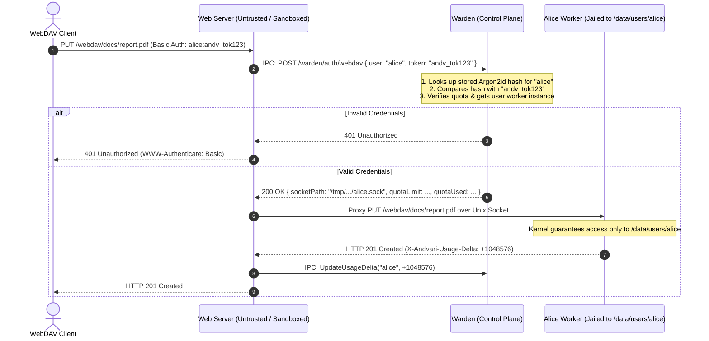
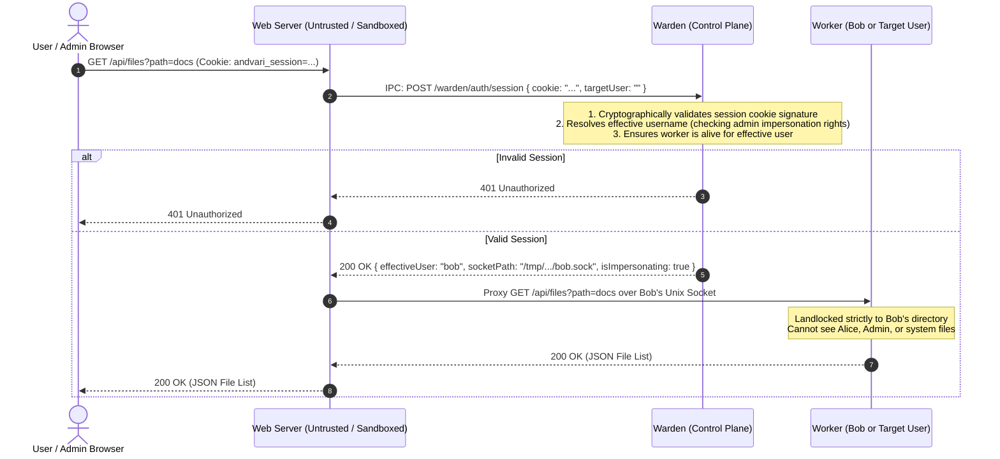
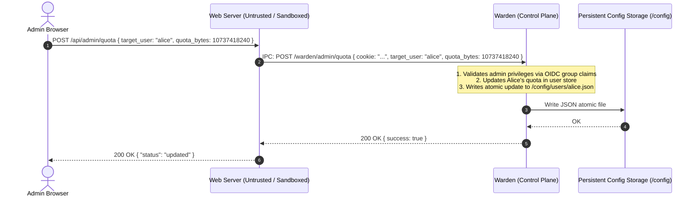

# Warden: Zero-Trust Control Plane & Sandboxed Web Server Architecture

## 1. Overview & Motivation

In multi-tenant storage systems, web servers are the most exposed component: they parse untrusted HTTP requests, handle complex multi-part uploads, terminate TLS, and interface with third-party identity providers. If a vulnerability (remote code execution, path traversal, SSRF, or memory corruption) compromises the web server process, standard architectures risk complete data exfiltration and credential theft.

Andvari introduces **Warden**—the trusted authority and control plane. Under this model:
- The **Web Server** is treated as an **untrusted, sandboxed reverse proxy**. It is denied kernel-level access to user data (`/data`) and configuration secrets (`/config`).
- **Warden** holds configuration, token hashes, and session verification authority. It listens exclusively on a local, root-restricted Unix domain socket (`warden.sock`).
- **Tenant Workers** execute file operations, each jailed strictly to a single tenant's directory (`/data/users/<user>`) via Linux Landlock LSM.

---

## 2. Process Topology & Privilege Matrix

```
                           +--------------------------------------+
                           |             CLIENT REQUESTS          |
                           |  (Browsers, WebDAV Clients, Mobile)  |
                           +-------------------+------------------+
                                               |
                                        [Public Port]
                                               v
                          +----------------------------------------+
                          |           WEB SERVER PROCESS           |
                          |            (`andvari __web`)           |
                          |                                        |
                          |  Kernel Landlock Sandbox:              |
                          |  - RW: WorkerDir (Unix Sockets only)   |
                          |  - RO: /etc/ssl, /etc/resolv.conf      |
                          |  - DENIED: /data (Tenant files)        |
                          |  - DENIED: /config (Secrets, Hashes)   |
                          |  - BLOCKED: execve (cannot spawn)      |
                          +-------------------+--------------------+
                                              |
                             [Unix Domain Socket: warden.sock]
                                              |
                                              v
                          +----------------------------------------+
                          |             WARDEN PROCESS             |
                          |          (`andvari` / supervisor)      |
                          |                                        |
                          |  Privileged Responsibilities:          |
                          |  - Holds Session Secrets & Argon2 DB   |
                          |  - Authenticates Tokens & Sessions     |
                          |  - Manages & Spawns Tenant Workers     |
                          |  - Updates Quotas & User Metadata      |
                          +---------+--------------------+---------+
                                    |                    |
             [Spawns via execve]    |                    | [Spawns via execve]
                                    v                    v
                   +-----------------------+      +-----------------------+
                   |     WORKER: ALICE     |      |      WORKER: BOB      |
                   |  (`andvari __worker`) |      |  (`andvari __worker`) |
                   |                       |      |                       |
                   | Landlocked to:        |      | Landlocked to:        |
                   | /data/users/alice     |      | /data/users/bob       |
                   +-----------------------+      +-----------------------+
```

### Privilege Matrix

| Resource / Capability | Web Server | Warden | Tenant Worker |
| :--- | :--- | :--- | :--- |
| **Public Network Listen (:8080)** | Serves HTTP/WebDAV | None | None |
| **`/data/users/*` (Filesystem)** | **DENIED (Kernel EACCES)** | None (no file I/O) | **RW (Own folder only)** |
| **`/config/users/*` (Hashes/Meta)**| **DENIED (Kernel EACCES)** | **RW (Owner)** | **DENIED (Kernel EACCES)** |
| **Session Secret / Signing** | **Opaque (No access)** | **Holds Secret** | None |
| **Process Execution (`execve`)** | **BLOCKED** | **Spawns Workers & Web** | **BLOCKED** |
| **IPC Communication** | Client on Unix sockets | Listens on `warden.sock` | Listens on user socket |

---

## 3. Detailed Request Flows

### Flow 1: WebDAV File Operations (`PROPFIND`, `PUT`, `GET`, etc.)

The Web Server receives Basic Authentication credentials, but cannot verify them or open the target file directly.



### Flow 2: Web UI File Explorer & Impersonation (`GET /api/files`)

The Web Server receives an authenticated session cookie from the browser, but cannot read session cryptographic secrets or access user directories on disk.



### Flow 3: Token Lifecycle & Admin Controls (`POST /api/tokens`, `POST /api/admin/quota`)

Mutations to user credentials, token hashes, and quotas are mediated by Warden. The Web Server never has write access to `/config`.



---

## 4. Failure Modes & Security Invariants

1. **Web Server RCE**: An attacker who obtains arbitrary shell or memory execution inside the web server process:
   - Cannot read any files in `/data` (blocked by Linux Landlock).
   - Cannot read or tamper with `/config` (blocked by Linux Landlock).
   - Cannot spawn new child processes or workers (blocked by Landlock / no exec permissions).
   - Cannot request arbitrary workers from Warden without valid cryptographic credentials or active session signatures.
2. **Worker Compromise**: An attacker exploiting a file-parsing vulnerability in Worker Alice:
   - Is permanently jailed to `/data/users/alice`.
   - Cannot touch Bob's data, host system paths, or Warden's configuration.
3. **Warden Isolation**: Warden never directly executes file operations or WebDAV parsing; its attack surface is strictly a clean, typed IPC interface on a private Unix socket.
